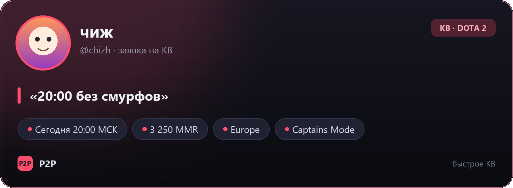

#  PrackBot — вызовы на КВ в Discord

Бот повторяет флоу из примера: **тикет → обработка → карточка с аватаром и ником → публикация в канал → отклики в ветке**.

```
/panel  →  кнопка «Создать вызов»
        →  модалка (заголовок, MMR, время, комментарий)
        →  предпросмотр (сервер + режим, выбор)
        →  PNG-карточка в канале вызовов + ветка
        →  «Принять вызов» → модалка (уровень, запись) → отклик в ветке + ЛС автору
```

Пример готовой карточки:



Закрытый вызов выглядит так: `preview_closed.png`.

## Что умеет

- **Тикет.** Заполнение заявки через кнопку и модалку Discord, без веб-форм.
- **Обработка.** Валидация полей, лимит 3 активных вызова на пользователя, выбор сервера и режима в предпросмотре.
- **Карточка.** Генерируется в PNG через Pillow: аватар, ник, цитата, чипы (время, MMR, сервер, режим), брендинг. Карточка закрытого вызова получает штамп «ВЫЗОВ ЗАКРЫТ».
- **Публикация.** Сообщение с карточкой, упоминанием автора и ролью-пингом (опционально).
- **Отклики.** Кнопка «Принять вызов» → модалка «Уровень команды / Запись» → отклик в ветке + уведомление автору в ЛС. Повторный отклик от того же игрока блокируется.
- **Закрытие.** Автор или модератор закрывает вызов: карточка перерисовывается, ветка архивируется.
- **Персистентность.** SQLite (`data/calls.db`), кнопки продолжают работать после перезапуска бота.

## Структура

```
main.py              запуск бота, синхронизация slash-команд
bot/config.py        настройки из .env
bot/card.py          рендер карточки (Pillow)
bot/db.py            SQLite-хранилище вызовов и откликов
bot/ui.py            модалки, кнопки, предпросмотр
bot/calls.py         логика: публикация, отклик, закрытие
tools/preview_card.py  локальный предпросмотр карточки без Discord
install.bat / run.bat  установка и запуск на Windows
```

## Установка (Windows)

1. Установи **Python 3.12** с [python.org](https://www.python.org/downloads/) и включи галочку **Add python.exe to PATH**.
2. В папке проекта запусти `install.bat` — он создаст `.venv` и поставит зависимости.
3. Скопируй `.env.example` в `.env`:

```bat
copy .env.example .env
```

### Настройка Discord

1. [Discord Developer Portal](https://discord.com/developers/applications) → **New Application**.
2. Вкладка **Bot** → **Reset Token** → скопируй токен в `DISCORD_TOKEN`.
3. Пригласи бота на сервер:
   - **General Information** → скопируй **Application ID** (это не секрет).
   - Подставь его в ссылку и открой в браузере:
     `https://discord.com/oauth2/authorize?client_id=APP_ID&permissions=326417632256&scope=bot%20applications.commands`
   - Выбери сервер → **Авторизовать**. Для этого нужны права «Управлять сервером».
   - Вручную: **OAuth2 → URL Generator**, scopes `bot` + `applications.commands`, права: `View Channels`, `Send Messages`, `Embed Links`, `Attach Files`, `Read Message History`, `Create Public Threads`, `Send Messages in Threads`, `Manage Threads`.
4. Включи **Developer Mode** в Discord (Настройки → Расширенные), правой кнопкой по серверу/каналу → **Копировать ID**.
5. Заполни `.env`:

| Переменная | Обязательно | Что это |
|---|---|---|
| `DISCORD_TOKEN` | да | токен бота |
| `CALLS_CHANNEL_ID` | да | канал, куда падают карточки вызовов |
| `GUILD_ID` | желательно | ID сервера — команды появятся сразу |
| `PING_ROLE_ID` | нет | роль, которую пингуем при новом вызове |
| `CARD_ACCENT` | нет | акцентный цвет карточки, например `"#ff4d6d"` |
| `CARD_BADGE` | нет | бейдж в углу карточки |
| `BRAND_NAME`, `BRAND_NOTE` | нет | подпись в подвале карточки |

6. Запусти `run.bat` (или `.venv\Scripts\python.exe main.py`).
7. В Discord напиши `/panel` в канале, где должна быть кнопка «Создать вызов». Панель отправится в текущий канал, карточки — в `CALLS_CHANNEL_ID`.

## Команды

| Команда | Доступ | Описание |
|---|---|---|
| `/panel` | Manage Server | отправить панель с кнопкой «Создать вызов» |
| `/call` | все | сразу открыть тикет вызова |

## Предпросмотр карточки без Discord

```bat
.venv\Scripts\python.exe tools\preview_card.py
```

Получишь `preview_open.png` и `preview_closed.png` — удобно подгонять цвета и текст, не запуская бота.

## Кастомизация

- **Цвета, бейдж, брендинг** — переменные в `.env` (`CARD_ACCENT`, `CARD_BADGE`, `BRAND_NAME`, `BRAND_NOTE`).
- **Серверы и режимы** — списки `SERVERS` / `MODES` в `bot/ui.py`.
- **Поля тикета** — `NewCallModal` в `bot/ui.py`.
- **Текст карточки** — `render_card` в `bot/card.py` (шрифты берутся из `C:\Windows\Fonts`, кириллица поддерживается).
- **Лимит активных вызовов** — `MAX_OPEN_CALLS` в `bot/ui.py`.
- **Сброс базы** — останови бота и удали `data/calls.db`.

## Частые проблемы

| Симптом | Причина / решение |
|---|---|
| Команды не появились | проверь `GUILD_ID`, перезапусти бота; при глобальной синхронизации Discord может думать до часа |
| `Missing Permissions` при публикации | у бота нет прав в канале вызовов: Send Messages, Attach Files, Create Public Threads |
| Карточка без аватара | не удалось скачать аватар — рисуется заглушка с первой буквой ника |
| Автор не получил ЛС | у автора закрыты личные сообщения от участников сервера; отклик всё равно остаётся в ветке |
| `python не найден` | Python не в PATH — переустанови с галочкой «Add python.exe to PATH» |
| Ошибка шрифта | добавь путь к шрифту в `_FONT_DIRS` в `bot/card.py` |

## Важно про хостинг

Бот должен работать постоянно. Для проверки хватит своего ПК (`run.bat`), для продакшена — VPS или любой хостинг с Python 3.11+. Файл `data/calls.db` — это состояние вызовов, его нужно сохранять между перезапусками.
